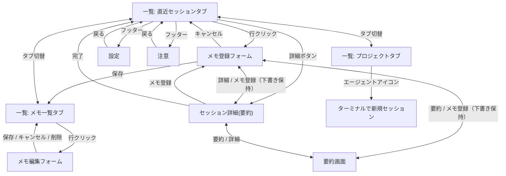

# Moost 設計

- **ステータス**: ドラフト
- **作成日**: 2026-07-09
- **前提資料**: [requirements.md](./requirements.md) / [CONTEXT.md](./CONTEXT.md)

Swift 製先行実装（claude-session-memo）で検証済みのロジックを Dart に移植する。
本書のファイル名・行番号の参照（`SessionHistoryReader.swift:51` 等）は先行実装のもの。

## 1. パッケージ構成

```
moost/                     （monorepo）
├── packages/
│   └── core/              pure Dart・UI 非依存
│       └── test/          core のみテスト（UI 層のテストはなし）
└── apps/
    └── desktop/           Flutter UI（macOS 先行）
```

### Swift 版との対応

Swift 版は Core と UI の依存方向が一方通行（Core は Foundation のみで SwiftUI/AppKit を
import しない）で、外部依存ゼロ。この性質を Dart 版でも維持する。

| Swift 版 | Dart 版の対応 |
|----------|--------------|
| `Sources/ClaudeSessionMemoCore/` | `packages/core/`（pure Dart + AgentAdapter 抽象化を追加） |
| `Sources/ClaudeSessionMemo/` | `apps/desktop/`（Flutter） |
| `Tests/ClaudeSessionMemoCoreTests/` | `packages/core/test/` |
| `scripts/build-dmg.sh` → `.github/workflows/release.yml` | CI（GitHub Actions）でのビルド・リリースワークフロー（リポジトリ側で管理・Swift 版 v2.0.0 以降） |

### core のコンポーネント（Swift 版 Core の 7 ファイルとほぼ 1 対 1）

| Swift 版 | 責務 | Dart 版での備考 |
|----------|------|----------------|
| `RecentSession` | 直近セッション 1 行分の表示データ（displayTitle 等） | |
| `Memo` | メモのデータ構造 + memos.json のルート構造 | `agent` フィールドを追加 |
| `MemoStore` | memos.json の読み書き（アトミック書き込み・破損時退避） | |
| `SessionHistoryReader` | `~/.claude/` の履歴読取・ai-title 抽出 | ClaudeCodeAdapter に収容 |
| `SessionTranscriptExtractor` | セッション JSONL から直近 N ラリーの会話抜粋を抽出 | ClaudeCodeAdapter に収容 |
| `SessionSummarizer` | `claude -p` による要約実行（claude パス自動検出含む） | ClaudeCodeAdapter に収容 |
| `TerminalLauncher` | AppleScript でターミナル復帰 | **唯一の OS 依存部**。Dart 版では OS 別実装に分かれる |

## 2. AgentAdapter 抽象

エージェント CLI ごとの差分をすべて adapter に閉じ込める。
core の他の部分と UI は adapter インターフェースにのみ依存する。
**当面の実装は ClaudeCodeAdapter のみ**。他プロバイダー（Codex CLI・Gemini CLI 等）は
将来この抽象に adapter を足すだけで対応できる状態を保つ。

吸収する差分は 4 つ:

| 責務 | Claude Code での実体 |
|------|---------------------|
| セッション履歴の場所とパース | `~/.claude/history.jsonl` |
| セッションタイトル・メタデータ取得 | セッション JSONL の `ai-title` 行 |
| 復帰コマンドの組み立て | `cd <projectPath> && claude --resume <sessionId>` |
| 要約用ヘッドレス実行コマンド | `claude -p`（stdin モード / `--resume --fork-session` モード） |

インターフェースに Claude 固有の概念（`~/.claude/` のパス構造、ai-title 等）を漏らさないこと。

## 3. データソース（Claude Code adapter）

### 3.1 history.jsonl — 直近セッション一覧の元データ

`~/.claude/history.jsonl` は 1 行 = 1 プロンプトの JSONL。各行が持つのは:

```json
{"display": "...", "pastedContents": {}, "timestamp": 1774028044215,
 "project": "/absolute/path", "sessionId": "uuid"}
```

集約ロジック（先行実装 `SessionHistoryReader.swift:51 recentSessions(limit:)`）:

- 全行を読み、1 行ずつ `(display, timestamp, project, sessionId)` にパースして
  `sessionId` 単位に集約する
- 同一 `sessionId` が複数ある場合は最新 `timestamp` を採用
- `display`（最後に打ったプロンプト）を `lastPrompt` として保持
- 要約用フォークセッションは、プロンプトがマーカー文字列で始まるもので除外
- パースできない行は例外にせずスキップ（内部フォーマット変更でクラッシュしない）

この時点では「タイトル」はなく、最終プロンプトしか持っていない。

### 3.2 セッション JSONL — ai-title の取得

セッション本体は `~/.claude/projects/<エンコード済みプロジェクトパス>/<sessionId>.jsonl`。
Claude Code 自身がタイトルを `{"type": "ai-title", "aiTitle": "..."}` 行として追記している
（Moost 側でタイトル生成はしない）。

取得ロジック（先行実装 `SessionHistoryReader.swift:107 aiTitle(sessionId:)`）:

1. **ファイル特定**: `~/.claude/projects/` 配下の全ディレクトリを走査し `<sessionId>.jsonl` を探す。
   ディレクトリ名のエンコード規則（`-Users-user-...` 形式)は内部仕様なので**あえて依存せず**、
   「ファイル名が UUID で一意」という性質だけを使う
2. **末尾 64KB だけ読む**: seek to end → 末尾から 64KB の位置に seek して読む。
   セッション JSONL は数十 MB になりうるため全読みしない。
   ai-title 行は会話が進むたびに追記されるので、最新のものはほぼ確実に末尾チャンク内にある
3. **末尾から逆順に行を走査**: 各行についてまず `"ai-title"` を含むかの安いフィルタをかけ、
   含む行だけ JSON デコードして `type == "ai-title"` を確認し `aiTitle` を返す。
   逆順走査なので最初のヒットが最新（タイトルは会話中に更新されるため最新を採用）

### 3.3 セッションタイトルの導出

3 段構え:

```
history.jsonl 集約（タイトルなし・lastPrompt のみ）
  → セッション JSONL 末尾の ai-title を探す
    → なければ lastPrompt 先頭 50 文字で代用
```

フォールバック（先行実装 `RecentSession.swift:33`）:

```swift
public var displayTitle: String {
    if let aiTitle, !aiTitle.isEmpty {
        return aiTitle
    }
    return String(lastPrompt.prefix(50))
}
```

設計上のポイントは 2 つ:
「末尾チャンク読み + 逆順走査」というパフォーマンス上の工夫と、
「ファイル名の UUID 一意性にだけ依存しエンコード規則に依存しない」
「パース失敗は全部スキップ」という内部仕様変更への耐性。

## 4. MemoStore

- 保存先: `~/.moost/v2/memos.json`（native 世代。パスの `v2` とエンベロープの
  `schemaVersion` で二重に版管理。v1 からの移行は DataMigration を参照）
- スキーマとエンベロープ形式は [requirements.md 3.3–3.4](./requirements.md) 参照
- **アトミック書き込み**: 一時ファイルに書いてからリネームする（書き込み中のクラッシュで
  memos.json を壊さない）
- **破損時退避**: 読み込み時に JSON として壊れていたら、上書きせず退避（リネーム保全）して
  空のストアから始める。メモデータを黙って失わない
- `MemoStore.update` は `title` / `tags` / `body` + `updatedAt` しか触らない。
  `id` / `agent` / `sessionId` / `projectPath` / `createdAt` は不変
- 復帰情報（`sessionId` + `projectPath`）はメモが自己完結で持つ（[ADR-003](./adr/003-self-contained-memo.md)）

## 5. 要約の実行と SummaryCache

- 実行エンジンは **4 経路**（Swift 版実装済み・2026-10-23 現在）:
  - **Claude**: `claude -p`（モデルは **haiku 固定**）。全体要約は
    `claude -p --resume <sessionId> --fork-session --model haiku`
  - **Codex**: `codex exec`（全体要約は `--resume --ephemeral` で fork 相当の分離）
  - **pi**: `pi`（設定の `piProvider` / `piModel` を反映。空欄なら pi の既定 → Issue #68）
  - **Hermes**: ヘッドレス要約コマンドを持たないため、`~/.hermes/state.db` から
    会話抜粋を**そのまま要約として返す**（pi と同じ方針・API 消費ゼロ）
- 2 モード（範囲）:
  - **直近要約**: 直近 N ラリー（1〜20・デフォルト 1）の抜粋をサブプロセスの stdin に渡す
  - **全体要約**: セッション全体を読んで要約（時間と利用枠を多く消費するため注意書きあり）
- 結果は**ディスクに保存しない**。アプリ常駐中のみ生きるメモリキャッシュ 1 つ:

```
SummaryCache: { "<sessionId>:full": "...", "<sessionId>:recent3": "..." }
```

- キーは セッション ID × 要約範囲。目的は永続化ではなく、同じセッション詳細を
  開き直したときに `claude -p` を再実行しないこと（時間と利用料の節約）
- 全体要約の副作用: fork したやり取り自体が Claude Code 側の新しいセッション JSONL として
  `~/.claude/` に残る（アプリの保存ではなく Claude Code の通常動作）。
  このゴミセッションはプロンプト先頭のマーカー文字列で直近セッション一覧から除外する。
  マーカーは Moost 独自のもの（例: `[Moost要約]`）を使う。Swift 版のマーカー
  （`[ClaudeSessionMemo要約]`）は除外対象にしない（同一マシンでの併用は想定しない）
- 非永続化の判断は [ADR-002](./adr/002-no-summary-persistence.md)

## 6. UI（フェーズ 2・macOS 先行）

- システムトレイ常駐・Dock アイコンなし。トレイアイコンクリックでポップアップ
  （Swift 版は NSStatusItem + NSPopover、570×660 固定。Flutter ではトレイ系プラグインで代替）
- **プラグイン選定結果（2026-07-09 監査・導入済み）**: tray_manager 0.5.3 +
  window_manager 0.5.1（いずれも leanflutter.dev、verified publisher、pana 160/160。
  native Swift を実監査し AppKit の UI API のみ使用＝ネットワーク・サブプロセス・
  動的ロードなしを確認）。window_manager は 0.5.2 が公開 7 日未満だったため
  クールダウンルールに従い 0.5.1 に固定。**launch_at_startup / package_info_plus は
  依存最小化のため見送り**（ログイン時自動起動とバージョン表示は将来対応）。
  Dock 非表示はプラグインではなく Info.plist の `LSUIElement` で実現
- 行クリック → 復帰先ターミナルで復帰コマンドを実行（設定で切替）。
  Terminal.app / iTerm2 は osascript、Kitty はリモコン（`kitten @ launch --type=tab`）で
  フォーカス中のウィンドウに新規タブを追加（詳細は 6.6 の注記参照）
- 各行に復帰コマンドのクリップボードコピーボタン
- コピー成功のフィードバックはボタン自体のアニメーションで行う: 緑の円周スイープ
  （時計回り・約 250ms）→ 緑のチェックマーク（約 400ms）→ 元のアイコンに戻る。
  設定 `copyAnimation` で OFF にできる（その場合はスイープ省略でチェックを
  やや長め表示）。OS の「視差効果を減らす」時も同様に省略。トースト/
  スナックバーは出さない。セッション詳細のメタ情報（セッション ID コピー）と
  メモ一覧・セッション一覧の行、セッション詳細・要約フッターに適用
  （Flutter 版 `CopyIconButton` / `CopyFeedbackTiming` と同じ）
- **コピーアイコンの見た目はコピー機能のないボタンと揃える**: アイコンは SF Symbols の
  既定サイズ・既定色（本文と同じ色）のままで、アニメーションの円弧は overlay 描画とし
  レイアウトサイズ・隣のボタンとの間隔に影響させない。緑色になるのはフィードバック中
  （円弧・チェックマーク）だけ（v2.2.1 で v2.1.0 以前と同一の見た目に統一）
- 設定項目の詳細は 6.6 参照

### 6.1 画面の種類

ポップオーバーという狭い領域のため、常に 1 画面だけを表示する。
画面遷移は enum のステートマシン（「今どの画面か」を 1 つの状態変数で持ち switch で切替。
スタック型ナビゲーションは使わない）。

| 画面 | 内容 |
|------|------|
| `list` | ルート画面。セグメントピッカーで「直近セッション」「メモ一覧」「プロジェクト」の 3 タブを切替。フッターに設定・注意・終了（**2026-10-02 にプロジェクトタブを追加**。v1/Flutter 版は元々 3 タブで、初版設計の 2 タブから機能差を埋めるため）。更新/修復ボタンは条件成立時のみ表示 → 6.8 |
| `newMemo` | メモ登録フォーム（対象の RecentSession を持つ） |
| `editMemo` | メモ編集フォーム（対象の Memo を持つ） |
| `sessionDetail` | セッション詳細 + 要約実行 |
| `summary` | 要約画面（メタ + 要約セクション + 最後の発言。2026-10-04 新設。メモ登録フォームのフッター「要約」から遷移） |
| `settings` | 設定 |
| `notes` | 注意画面（下記 4 点の説明） |

注意画面に記載する内容（Swift 版の実機 UI より）:

1. **ターミナル操作の権限**: 復帰（`claude --resume`）の初回実行時に macOS の
   オートメーション権限ダイアログが出る。「許可」を選べば以後は表示されない
2. **セッションの保持期間**: セッション実体は Claude Code が `~/.claude/projects` に保持し、
   保持期間は Claude Code の設定 `cleanupPeriodDays`（デフォルト 30 日）に依存する。
   **メモを登録していても期限切れのセッションには復帰できない場合がある**
   （Claude Code のセッション管理ドキュメントへのリンクを添える）
3. **Claude 要約について**: 要約は `claude -p`（モデル: Haiku）で実行され、
   実行のたびに Claude の利用枠を消費する。対象範囲は「直近 1〜20 ラリー」（デフォルト 1、
   ローカルで抜粋してから渡すため高速・低コスト）または「全体」（セッション全体を読むため
   時間と利用枠を多く消費）
4. **直近セッション一覧の更新タイミング**: ポップオーバーを開いたとき・タブを切り替えたときに
   自動再読込。手動リロード不要。開きっぱなしの間は更新されない
   （メモ・プロジェクトの追加/更新/削除は再読込せず **ローカル即時更新**。
   全セッション集計の再実行によるラグを避けるため。2026-10-03）

各画面の主な要素（Swift 版の実機 UI で確認済み）:

- **一覧（3 タブ共通）**: 各行にタイトル・プロジェクト名・日時。行内ボタンは v1（Flutter 版）互換:
  セッション行 = ターミナル（ワンクリック再開）→ 詳細 → コピー、
  メモ行 = ターミナル（再開）→ コピー → ゴミ箱（削除）。削除はインライン確認行に置き換わる。
  フッターに設定・注意・終了（＋更新/修復ボタンは 6.8 の条件成立時のみ）。一覧はポップオーバーを開いたとき・タブを切り替えたときに
  自動再読込する（手動リロードなし。開きっぱなしの間は更新されない）
- **プロジェクトタブ（2026-10-02 追加）**: 登録したディレクトリのリスト。
  各行に表示名・パス・登録日と、エージェント（Claude / Codex / pi / Hermes）ごとのターミナルアイコン
  （クリックでそのディレクトリを cwd に新規セッション開始）と削除ボタン。
  ヘッダーのフォルダ追加アイコンは **NSOpenPanel.begin（独立ウィンドウ）**でディレクトリ選択 → 登録
  （2026-10-03。`runModal()` はポップオーバーを閉じ、SwiftUI `.fileImporter` / `beginSheetModal`
  はポップオーバーの非アクティブ監視（外側クリックで閉じる）を恒久的に壊すため不採用。
  外側クリックで閉じるのは didResignActive の自前監視で実現 → 6.3-6 参照）。
  削除はダイアログではなくインライン確認（6.3-4 と同じポップオーバー制約への対処）
- **セッション詳細**: メタ情報（タイトル / プロジェクト / セッション ID（コピー付き） /
  最終利用日時 / 最終プロンプト）、要約範囲のセグメント（直近/全体）+ ラリー数ステッパー、
  「✨ {そのセッションのエージェント} で要約する」ボタン（Claude=haiku 固定 / Codex / pi、
  設定の piProvider/piModel 反映。**Hermes は抜粋テキストをそのまま表示**（API 消費ゼロ）。
  バックグラウンド実行 + メモリキャッシュ、エラー/結果表示）、
  下部に「メモ登録」（2026-10-04 に「このセッションをメモ」から簡潔化）「要約」（要約画面へ）
  「復帰コマンドをコピー」「ターミナルで開く」（prominent）、右上に「戻る」→ 6.3-8
- **要約画面（2026-10-04 新設）**: ScreenHeader「要約」+ メタ情報（MetaPanel）+ 要約範囲
  セグメント（直近/全体）+ ラリー数ステッパー +「✨ pi で要約する」+「最後のあなたの発言」。
  下部に「メモ登録」「詳細」・「復帰コマンドをコピー」「ターミナルで開く」（prominent）。
  メモ登録フォームのフッター「要約」から開き、「要約を見ながらメモを書く」フローを担う → 6.3-8
- **メモ登録フォーム**: **「このメモの元セッション」ブロックにメタ情報を統合**（エージェント
  バッジ・プロジェクトパス・セッション ID・日時・最後のあなたの発言。2026-10-04 ユーザー実機
  フィードバックで MetaPanel との二重表示を解消）。タイトル（最後の発言が初期値）・タグ・本文の
  3 入力は**ラベル上・フィールド下の左寄せ**（`.formStyle(.grouped)` の macOS 2 カラムが右寄せに
  見えたため変更。NewMemo / EditMemo 共通）。**要約セクションはここには置かず**、要約は
  「要約画面」「セッション詳細画面」のみ（2026-10-04 確定）。下部に「キャンセル」「要約」「詳細」
  …「保存」（6.3-8）
- **メモ編集フォーム**: 登録フォームと同構成 + **「ターミナルで再開」ボタン**（メモからの復帰動線。
  メモの自己完結性が UI に現れる場所）と削除ボタン。削除を押すと確認行
  （「このメモを削除しますか？ キャンセル / 削除」）に置き換わる
- **設定**: 6.6 の各項目 + MCP 連携セクション + 画面下部にアプリのバージョン表示

### 6.2 遷移図



### 6.3 遷移設計の特記事項（Swift 版で検証済み）

1. **戻り先のタブまで制御する**: 登録フォームで保存するとメモ一覧タブへ
   （登録したメモを確認できるように）、キャンセルすると直近セッションタブへ
   （入口だった画面に）と、ユーザーの意図に合わせて戻り先を変える
2. **登録フォーム⇄詳細/要約は遷移しても下書きを保持する**: 「要約を見ながらメモを書く」
   フローを守るため、フォームから詳細/要約へ遷移しても入力中の下書きを破棄しない
   （`AppModel.detailReturnTo` で戻り先を保持。2026-10-04 から詳細/要約は別画面遷移に変更。
   かつてはフォーム内部のフラグで重ねて表示していたが、画面遷移でフォームが破棄されるため
   不採用だった経緯がある → 6.3-8）。
   **初期状態は表示 true**（2026-10-03 ユーザー要望: 初めから見えるほうがいい。
   隠したい場合は下部トグル「セッション詳細を隠す」で）。
   **2026-10-04 更新**: トグルは廃止し常時表示。登録フォームではメタ情報のみを表示し、
   要約セクションは要約画面（summary）とセッション詳細画面（info アイコン）に限定 → 6.3-8
3. **遷移ロジックはルート画面に集約**: 各画面はコールバック（onFinish / onCancel / onDone）で
   遷移を親に依頼するだけで、自分で画面状態を書き換えない。遷移図とコードが 1 対 1 で対応する
4. **削除確認はダイアログではなくフォーム内のインライン UI**: 別ウィンドウやダイアログを出すと
   ポップオーバー自体が閉じてしまうという、常駐ポップオーバー特有の制約への対処
5. **メモ・プロジェクトの CRUD は refresh()（全読み込み）を呼ばない**（2026-10-03）:
   保存・更新・削除後は対象一覧（model.memos / model.projects）を**ローカル即時更新**する。
   refresh() は全セッションの読み込み・集計（数百 ms）を含むため、毎回呼ぶと操作のたびに
   ラグが出る。refresh() は起動時・タブ切替時のみ。メモ削除の成功トーストも出さない
   （行が消えるだけで十分。v1 互換）
6. **ファイル選択は NSOpenPanel.begin（独立ウィンドウ）+ 外側閉じは didResignActive 自前監視**:
   `NSOpenPanel.runModal()` はモーダルセッション開始で NSPopover を閉じてしまう（2026-10-03）。
   SwiftUI `.fileImporter`・`beginSheetModal`・`begin` のどれも、表示後に NSPopover の
   **非アクティブ監視（transient = 外側クリックで閉じる）を恒久的に失う**（スモーク実測）。
   解決: `popover.behavior = .applicationDefined` + `NSApplication.didResignActiveNotification`
   の自前監視で performClose（=「moost 以外の場所をクリックで閉じる」を確実に再現）。
   **ピッカーの z 順**: NSOpenPanel は layer=0（通常）のためポップオーバー（layer=25）の
   背面に隠れる → `panel.level = popoverWindow.level + 1` + `orderFrontRegardless()` で
   前面に出す（2026-10-03 ユーザー報告）。
   **ピッカーの表示位置**: アンカー（フォルダ追加ボタン上のマウス位置）にピッカーの
   **ヘッダー（上端）** が来るように表示（ユーザー要望 2026-10-03。カーソルがヘッダー
   ~28px に乗る）。**origin.y = anchor.y - 14 - height**（上端 = origin.y + height がアンカー
   の直下。2026-10-03 実測で `anchor.y - 14` を origin.y に代入する誤りがあったため、
   クランプで画面下部に落ちていた）。下方向に収まらない場合は上方向展開（下端 = anchor.y + 14、
   画面下にピッカーを置く場合）→ クランプの順でフォールバック。x は水平中心。
   アンカーがある画面内に 16px マージンでクランプ。moost との重なりは許容。
   ピッカー高さは 420 に縮小（幅は NSOpenPanel の最小幅 ~820 が適用されるので触らない）。
   経緯: ①メイン画面中央（moost を覆う）→ ②別画面中央（「全然違う」）→ ③ポップオーバー左隣
   → ④カーソル位置中心 → ⑤カーソル位置にヘッダー（origin.y の誤りで不発）→ ⑥**ヘッダーが
   アンカー直下・画面内クランプ（確定・ユーザー実機確認済み 2026-10-03「治っています！」）**。
   完了時はポップオーバーを閉じずキーのみ戻す（performClose→show の点滅は廃止済み）。
   AppModel は `requestRegisterProject()`（パネル表示依頼）と `registerProject(path:)`（登録）に分離。
   **クリック位置の取得**: `NSApp.currentEvent` はスモークからの呼び出しで別イベントを拾い
   クリック位置が化ける（実測で (0,900) を返した）ため使用せず、`NSEvent.mouseLocation`
   に統一（実クリック直後はマウスがボタン上にあるため十分正確）。ボタン位置は
   `ScreenPointReporter`（NSViewRepresentable + convertToScreen）で AppKit グローバル座標
   （左下原点）として AppModel.projectAddButtonFrame に報告。SwiftUI の geo.frame(in: .global)
   は左上原点で NSOpenPanel.frame / NSEvent.mouseLocation（左下原点）と混同しやすい

### 6.3-7 メモ登録フォームのレイアウト仕様（2026-10-04 確定・ユーザー実機確認済み）

幅はポップオーバー（570 × 660）基準。左右 12px の余白でコンテンツ共通幅は 546px。

| # | 要素 | 幅 | 高さ | 枠線 / 背景スタイル | 内容・スタイル |
|---|---|---|---|---|---|
| 1 | 見出し「メモを登録」（ScreenHeader） | 全幅 570px（水平 padding 12） | 約 33px | 枠なし・透明 | 15pt semibold・左寄せ。戻るボタンなし |
| 2 | 「このメモの元セッション」カード（InlineSessionDetail） | **546px（入力欄と同一幅）** | 約 82px（内容で可変） | **角丸 6・1px 枠線（separatorColor）・背景 controlBackgroundColor** | 内部 padding 水平 10/垂直 6。見出し 11pt medium / pi バッジ + パス 11pt secondary / ID + 日時 10pt secondary / 最後の発言 11pt（最大 3 行） |
| 3 | 「タイトル」ラベル | 546px | 約 14px | 枠なし | 11pt secondary・下間隔 2 |
| 4 | タイトル入力欄（TextField） | **546px（全幅）** | 標準約 22px | **`.roundedBorder`（システム標準角丸ボックス・1px グレー枠・白背景）** | 左寄せ。draftTitle |
| 5 | 「タグ（カンマ区切り）」ラベル | 546px | 約 14px | 枠なし | 11pt secondary |
| 6 | タグ入力欄（TextField） | **546px（全幅）** | 標準約 22px | **`.roundedBorder`（同上）** | 左寄せ。draftTags |
| 7 | 「本文」ラベル | 546px | 約 14px | 枠なし | 11pt secondary |
| 8 | 本文入力欄（TextEditor） | **546px（全幅）** | **最小 120px**（内容で伸長） | **システム標準（角丸 + スクロール・白背景）** | 12pt。draftBody |
| 9 | ボタン行（フッター） | 全幅 570px（水平 padding 12） | 約 34px | 枠なし | 左から「キャンセル」（枠あり）/「✨ 要約」（sparkles）/「ⓘ 詳細」（info.circle）。右端「保存」（`.keyboardShortcut(.defaultAction)` = 青の強調ボタン・タイトル空で無効） |

幅の関係: 元セッションカード（#2）＝ タイトル/タグ/本文フィールド（#4/#6/#8）＝ **546px**。
見出しとボタン行は 570px（端まで）。カードのみ角丸 6 + separator の枠線、
入力欄はシステム標準の角丸ボックス（角丸・枠色が異なる）。

**経緯（2026-10-04）**: ① MetaPanel（エージェント/パス/ID/日時）と InlineSessionDetail
（パス/ID/日時/最終発言）の二重表示 → InlineSessionDetail に統合。② `.formStyle(.grouped)` の
macOS 2 カラム（ラベル左・フィールド右）が右寄せに見える → ラベル上・フィールド下の左揃えに。
③ 幅: テキスト幅（狭）→ 全幅帯（広）→ 18px 内側カード（狭）→ **全幅角丸カード（確定）**。
④ フッターに「要約」「詳細」ボタンを追加（→ 6.3-8）。

### 6.3-8 メモ登録・要約・詳細画面のフッターと相互遷移（2026-10-04 確定・ユーザー実機確認済み）

メモ登録画面のフッターから要約・詳細を開き、**3 画面を相互遷移できる**。

| 画面 | 左ボタン | 右ボタン |
|---|---|---|
| メモ登録（NewMemoScreen） | 「キャンセル」／「✨ 要約」（sparkles）／「ⓘ 詳細」（info.circle） | 「保存」（青の強調・タイトル空で無効） |
| 要約（SummaryScreen・新設） | 「📝 メモ登録」（square.and.pencil）／「ⓘ 詳細」（info.circle） | 「⧉ 復帰コマンドをコピー」／「🖥 ターミナルで開く」（prominent） |
| 詳細（SessionDetailScreen・既存） | 「📝 メモ登録」（square.and.pencil）／「✨ 要約」（sparkles） | 「⧉ 復帰コマンドをコピー」／「🖥 ターミナルで開く」（prominent） |

仕様:

1. **要約画面（SummaryScreen）の構成**: ScreenHeader「要約」+ メタ（MetaPanel）+
   SummarySection（直近/全体・ラリー数・✨ pi で要約する）+「最後のあなたの発言」。
   要約を見ながらメモを書くフローを維持（6.3-2 の懸念への回答）
2. **詳細画面**: 既存 SessionDetailScreen を再利用（メタ + SummarySection + 最後の発言）。
   要約機能は詳細画面からも利用可能（退化させない）
3. **文言統一**: 「このセッションをメモ」→「**メモ登録**」（簡潔化・2026-10-04）
4. **戻り先制御（AppModel）**: `detailReturnTo` + `rememberDetailReturn()`。
   新規メモから要約/詳細を開いた場合、詳細/要約**間**の移動では戻り先を上書きせず、
   どの経路でも「戻る」でメモ登録画面（下書き保持）へ一発復帰。
   一覧の info アイコンから開いた場合は従来どおりセッション一覧へ戻る
5. **メモ登録画面には要約セクションを置かない**（2026-10-04 ddeabb2 決定）。
   要約は要約画面・詳細画面のみ
6. **遷移図**: メモ登録 ⇄ 要約 ⇄ 詳細（フッターボタンで相互遷移・ヘッダー「戻る」で逆方向）

### 6.4 Flutter での再現方針

- enum ステートマシンは **sealed class + 単一の状態変数**でそのまま移せる。
  Navigator を使うより「1 画面 switch」方式を維持するほうがポップアップの UX に合う
- 特記事項 2・4 の「ポップオーバーを閉じさせないための工夫」は Flutter のトレイポップアップでも
  同種の問題が起きる（7 章ハマりどころ 5 参照）

### 6.5 フォント

Swift 版は 3 種類だけで全画面をまかなう（すべてシステムフォント）。

| 名前 | サイズ | ウェイト | 用途 |
|------|--------|---------|------|
| appHeadline | 15pt | semibold | 画面タイトル（「メモを登録」「セッション詳細」等） |
| appBody | 14pt | regular | 本文・リスト行・フォーム入力（アプリ全体のデフォルト） |
| appCaption | 10pt | regular | 補足（プロジェクトパス・セッション ID・注意書き・ヘルプ文言） |

設計上のポイント:

1. **一元管理**: フレームワーク標準のテキストスタイルを直接使わず独自定数に集約し、
   「3 つの数値だけ変えれば全画面に反映される」構造にする
2. **ルートで一括適用**: ポップオーバー全体のデフォルトを appBody（14pt）にし、
   タイトルとキャプションだけ各画面で個別指定する

Flutter では ThemeData の textTheme に 3 スタイル
（titleMedium 15/semibold・bodyMedium 14・bodySmall 10 あたりにマッピング）を定義して
同じ構造を再現する。**注意**: 10pt のキャプションは macOS 前提の値で、
Flutter や Windows/Linux ではレンダリングやスケーリングの違いでつぶれて見えることがあるため、
クロスプラットフォーム化の際は 11〜12 相当へ上げる余地を残しておく。

### 6.6 設定

設定画面の項目（Swift 版で実装済み・2026-10-14 更新）:

| 項目 | 選択肢・範囲 | デフォルト | 保存キー |
|------|-------------|-----------|---------|
| 復帰先ターミナル | Terminal.app / iTerm2 / Kitty | Terminal.app | `terminalApp` |
| 直近セッション表示件数 | 5〜100（5 刻みのステッパー） | 20 | `recentSessionLimit` |
| claude コマンドのパス | 自由入力（`~` 展開あり。空欄なら自動検出） | 空欄 | `claudePath` |
| pi プロバイダー名 | 自由入力（空欄で pi の既定に従う） | 空欄 | `piProvider` |
| pi モデル名 | 自由入力（空欄で pi の既定に従う） | 空欄 | `piModel` |
| ログイン時に自動起動 | ON / OFF | OFF | （設定ファイルではなく OS 管理） |
| コピー成功アニメーション | ON / OFF | ON | `copyAnimation` |

**Kitty の開き方（native v2.3.0 追加、v2.3.1 でソケット探索を実機仕様に修正）**: Kitty は
AppleScript 非対応のため、リモコン経路（`kitten @ … launch --type=tab`）で
前面のウィンドウに新規タブを追加する。タブにするには
`~/.config/kitty/kitty.conf` に次の 2 行が必要（既定はオフ）:

```
allow_remote_control yes
listen_on unix:/tmp/moost-kitty.sock
```

ただし kitty は**設定ファイル由来の `listen_on` に PID を付与**する
（`/tmp/moost-kitty.sock` → `/tmp/moost-kitty.sock-<pid>`。CLI の `--listen-on` では
付与されない — kitty `main.py expand_listen_on`）。そのため Moost は
CGWindowList から前面の kitty ウィンドウのオーナー PID を取得し、
`unix:/tmp/moost-kitty.sock-<pid>` の候補から順に接続を試す
（前面インスタンス → CLI 固定パス → 残りのウィンドウ → /tmp グロブ。
`kitten @ … ls` で生存確認）。複数インスタンスでも「今開いている」ウィンドウへ
タブを開ける。`listen_on` はリロードでは反映されないため、2 行の追記後は
**Kitty の再起動が必要**。
未設定・Kitty 未起動時は `/usr/bin/open -n -a kitty --args …` で新しいウィンドウ
（別インスタンス）として開き、設定案内のトーストを初回のみ表示する

#### Kitty のリモコン設定（`~/.config/kitty/kitty.conf`、2026-10-21 実機確認）

Moost からのタブ復帰に必要なのは次の 2 行（既定は両方ともオフ）:

```
allow_remote_control yes
listen_on unix:/tmp/moost-kitty.sock
```

書き方の注意:

1. **追記後は Kitty を再起動する**。`listen_on` はリロード（`kitty @ reload` や設定監視の
   再読込）では反映されない（kitty 0.49.1 `options/definition.py` に
   「Changing this option by reloading the config is not supported.」と明記）。
   変更が効いているかは `ls /tmp/moost-kitty.sock*` でソケットの実体を確認できる
2. **ソケットの実体には PID が付く**: 実際にできるのは `/tmp/moost-kitty.sock-<kitty_pid>`
   （設定ファイル由来の `listen_on` にのみ付与。CLI の `--listen-on` では付かない —
   kitty `main.py expand_listen_on`）。Moost 側はこの PID 付きパスを引けるように
   前面ウィンドウのオーナー PID（CGWindowList）から候補を組み立てて接続する
3. **複数インスタンスの注意**: 同じ `listen_on` パスを複数の kitty インスタンスが共有すると
   ソケットは最後に起動したインスタンスが握る。Moost は画面の前面ウィンドウの
   オーナー PID と一致するソケット（`-<pid>`）を最初に試すため、ウィンドウ単位で
   起動中の正しいインスタンスへタブを開ける（v2.3.1 で対応）

動作確認（Kitty 側）:

```
ls /tmp/moost-kitty.sock*                          # ソケット実体（-<pid> 付き）の確認
kitten @ --to unix:/tmp/moost-kitty.sock-<pid> ls  # 接続テスト（応答が出れば OK）
kitten @ --to unix:/tmp/moost-kitty.sock-<pid> launch --type=tab /bin/zsh -lc 'echo ok > /tmp/t.txt'
```

実機検証メモ（2026-10-21）: 2 行入りの設定ファイルで一時インスタンスを起動し、
ソケット `-<pid>` の生成・CGWindowList のウィンドウオーナー PID との一致・
`launch --type=tab` でのタブ起動を確認済み。検証用インスタンスは削除済みで、
既存のウィンドウには影響なし

これに加えて **MCP 連携セクション**がある（2026-10-04 追加）: Claude Code / Codex CLI /
Claude Desktop へ `moost mcp` を登録（処理中スピナー・`mcpBusyTarget` で状態表示）。
保存先は各外部ツール側で、moost の設定ファイルには持たない。

補足（Swift 版で検証済みの作り）:

- **claude パス欄は要約機能（`claude -p`）専用**。ターミナル復帰のほうはログインシェルで
  実行されるので PATH 解決に問題がなく、パス指定は不要。欄の下に
  「自動検出: /Users/.../claude」と現在の検出結果を表示し、設定ミスに気づけるようにする
- **piProvider / piModel は pi 起動時（要約・ターミナル復帰）の `--provider` / `--model`** に
  反映される。空欄の場合は付けず pi の既定に従う
- **ログイン時自動起動だけ保存先が特殊**: 設定ストアに持たず OS
  （macOS では ServiceManagement / SMAppService）に委ね、画面表示のたびに OS の実状態を読む。
  システム設定側で変更されてもズレない。登録失敗時はエラーを表示してトグルを実状態に戻す

設定画面外で永続化される 1 項目:

| 項目 | 範囲 | デフォルト | 保存キー |
|------|------|-----------|---------|
| 要約対象のラリー数 | 1〜20 | 1 | `summaryRallyCount` |

セッション詳細 / 要約画面のステッパーで変更する。設定画面には出さないが永続化する
（「使う場所で調整する値は使う場所に置く」という整理）。
一方「直近/全体」の要約範囲切替は永続化せず、画面を開くたびに「直近」に戻る。

### 6.7 設定の保存先

OS 設定ストア（UserDefaults / レジストリ / XDG）には**保存しない**。
**`~/.moost/v2/settings.json`（メモと同じディレクトリの専用設定ファイル）** に保存する。

理由: shared_preferences 等の OS 設定ストアは実体の保存先が OS ごとにバラバラ
（macOS は UserDefaults、Windows はレジストリ、Linux は XDG ファイル）で場所も不透明。
専用ファイルなら **全 OS で同じ方式**になり、memos.json と同じく
「人が読める・アプリを消しても残る・デバッグやバックアップが容易」という性質が揃う。

- 書き込みは MemoStore と同じくアトミック書き込み + 破損時退避
- メモ本体（`memos.json`）とはファイルを分ける
- **例外: ログイン時自動起動だけは settings.json に持たない**。これは設定値ではなく
  OS への登録そのもの（macOS は ServiceManagement、Windows はスタートアップ登録、
  Linux は autostart）なので、Swift 版と同じく「OS 側の実状態を正とし、保存せず毎回読む」。
  Flutter では launch_at_startup パッケージ経由
- 多エージェント化の際は「claude コマンドのパス」を adapter ごとの設定
  （`agentPath` の辞書）に一般化する必要がある

### 6.8 アプリ内更新（フッターの更新/修復ボタン、2026-10-14 確定・v2.1.0 実装済み）

Flutter 版 Issue #12（更新通知 + brew 更新/修復）の native 移植。
**設定画面の更新セクションは廃止**し、一覧フッターのインラインピルに集約する。
理由は 6.3-4 と同じポップオーバー制約（ダイアログを出すと閉じてしまう）で、
Flutter 版と同じ「小さい はい/いいえ」のピル UI を踏襲する。

**表示条件**（ListScreen が制御）:

| 条件 | 表示 |
|------|------|
| `updateInfo != nil`（新バージョンあり） | 「アップデート」ボタン（arrow.up.circle） |
| `installBroken == true`（破損検知） | 「修復」ボタン（exclamationmark.triangle） |
| どちらもなし | 表示しない（フッターは通常どおり） |

表示は `.id("\(version)-\(installBroken)")` でビューを再生成し、フェーズを初期化する
（バージョン変更・破損状態の変化で前回の確認状態が残らないように）。

**更新チェック**（UpdateChecker・docs/app-update-check-methods.md 方式 7）:

- `HEAD https://github.com/rami2076/moost/releases/latest`
  （User-Agent `Moost/<currentVersion>`・タイムアウト 5 秒）
- `NoRedirectDelegate` で 302 の `Location` を捕捉し、タグ `v<semver>-<platform>` をパース
- `semverCore`（`-macos` / `+build` を除去・ゼロ埋め）で比較し、新しい場合のみ `UpdateInfo` を返す
- **失敗しても沈黙**（nil を返すだけ）。GitHub Releases API はレート制限があるため使わない
- 実行タイミング: 起動時 + ポップオーバー前面化時。間隔 5 分（`updateCheckInterval`）以内は再実行しない

**状態機械**（UpdateButtonModel.Phase）:

```text
idle ──タップ(brew 管理 or 破損)──▶ confirming
idle ──タップ(手動導入)───────────▶ リリースページを開く（idle のまま）
confirming ──はい──▶ running ──成功──▶ done（再起動）
              │              └──失敗──▶ failed(メッセージ)
              └──いいえ──▶ confirmCopy ──はい──▶ copied ──3秒後──▶ idle
                                      └──いいえ──▶ idle
failed ──再試行タップ──▶ confirming（確認からやり直し）
done ──再起動タップ──▶ アプリ再起動
```

| フェーズ | 表示 | 動作 |
|---|---|---|
| `idle` | 「アップデート」/「修復」ボタン | タップで confirming（brew 管理外ならリリースページを開くだけ） |
| `confirming` | ピル「アップデートしますか? はい/いいえ」（破損時は「アプリの状態を修復しますか?」） | はい → running / いいえ → confirmCopy |
| `confirmCopy` | ピル「アップデートコマンドをコピーしますか? はい/いいえ」 | はい → copied / いいえ → idle |
| `copied` | ピル「コマンドをコピーしました」（チェックマーク） | 3 秒後に idle（`copiedHoldDuration`） |
| `running` | ピル「更新中…」+ スピナー | `Task.detached` で brew を実行（UI は塞がない）。進捗 % は brew の出力に無いため表示しない |
| `done` | 「再起動」ボタン（checkmark） | 再起動 → `/usr/bin/open /Applications/Moost.app` + `NSApp.terminate(nil)` |
| `failed(メッセージ)` | ピル（⚠ 赤）+ 再試行 + エラーコピー（doc.on.doc） | 再試行タップ → confirming / コピーでエラーメッセージをクリップボードへ |

`expandedPhases`（{confirming, confirmCopy, copied, running}）はフッターの他ボタンを隠すほど
幅を取るフェーズ（Flutter の `_expandedPhases` と同じ考え方）。

**brew 実行**（BrewUpdater）:

- brew パス解決は 3 段階: `/opt/homebrew/bin/brew` → `/usr/local/bin/brew` →
  `zsh -lc "command -v brew"`（AgentPathDetect と同じ方針）。見つからなければ `brewNotFound`
- 更新: `brew update && brew upgrade --cask moost`
- 修復: `brew reinstall --cask moost`。空になった `/Applications/Moost.app` は先に削除して再試行
- 実行は `Task.detached(priority: .userInitiated)` のブロッキング Process。
  パイプを先に排出してから `waitUntilExit`（出力滞留でのデッドロック防止）

**インストール破損検知**（InstallHealthChecker・Flutter 版 Issue #58 の移植）:

- brew 管理下（`/opt/homebrew/Caskroom/moost` or `/usr/local/Caskroom/moost` にレコードあり）のみ判定
- 判定条件: `*.upgrading` の残骸、または `/Applications/Moost.app/Contents/MacOS/MoostApp` の欠落
- **Flutter 版との差**: 実行ファイル欠落を常に破損としない（手動導入には修復手段がなく、
  開発環境の誤検知につながるため native 版では brew 管理下に限定）

**設計上の注意**:

- モーダル・ダイアログ禁止（6.3-4 / 7章【5】）→ すべてインラインのピル UI
- **自動ダウンロードはしない**: URLSession で dmg を落とすと quarantine 属性が付き、
  更新に失敗する（native-migration-plan 5.3）。手動導入ユーザーには
  idle タップでリリースページを開く動線だけを提供する
- 再起動は `open`（NSWorkspace ではなく `/usr/bin/open` の Process）+ `terminate`
  （Flutter の restartApp と同じ「起動してから終了」順）

## 7. 既知のハマりどころ（先行実装で確認済み。同じ穴に落ちないこと）

1. **GUI アプリの PATH 問題**: Finder/ランチャーから起動すると PATH が最小限になり、
   `.zshrc` を読まないため bare な `claude` が解決できない。3 段構えで解決する:
   既知パス（`~/.local/bin` 等）の探索 → 対話シェルでの `whence` 解決 → 設定での手動上書き
2. **パイプバッファのデッドロック**: サブプロセスの stdout/stderr は
   `waitUntilExit` 相当の前に EOF まで読み切ること（読まないとパイプバッファ詰まりでデッドロック）
3. **フォークセッションの混入**: 要約用に fork したセッションが直近セッション一覧に混ざらないよう、
   要約プロンプトの先頭にマーカー文字列を入れて一覧から除外する
4. **シェルエスケープ**: `projectPath` にバッククォートが含まれるケースの
   シェルエスケープを必ずテストする
5. **ポップオーバーからダイアログ・別ウィンドウを出さない**: モーダルダイアログや別ウィンドウを
   出すとトレイポップオーバー自体が閉じてしまう。確認 UI（削除確認等）はフォーム内の
   インライン表示で実現する。**ファイル選択は `NSOpenPanel.begin`（独立ウィンドウ）**:
   `runModal()` はポップオーバーを閉じ、`fileImporter`/`beginSheetModal` は閉じた後も
   外側クリックで閉じない（非アクティブ監視が壊れる）。**NSPopover の transient は
   applicationDefined + didResignActive 自前監視に置き換える**（2026-10-03 全方式実測）
6. **macOS の App Sandbox を無効にする**（Flutter 版で確認）: Flutter の macOS テンプレートは
   デフォルトで App Sandbox が有効になっており、`~/.claude/` が読めず
   `Platform.environment['HOME']` もコンテナ内を指すため、一覧が空になる。
   CLI では動くのに GUI で動かない場合はまずこれを疑う。
   `DebugProfile.entitlements` / `Release.entitlements` の
   `com.apple.security.app-sandbox` を `false` にする（App Store 配布はしない前提）
7. **flutter_test の FakeAsync と実ファイル I/O**（Flutter 版で確認）: テスト本体（FakeAsync
   ゾーン）では dart:io の非同期 Future が永遠に完了せず、テストが黙ってハングする。
   実 I/O は `tester.runAsync` の中で行い、その外では同期 API（`createTempSync` 等）を使う。
   スピナー表示があるため `pumpAndSettle` も使えない（明示的に `pump` を打つ）
8. **最後のウィンドウを閉じるとアプリごと終了する**（Flutter 版で確認）: macOS テンプレートの
   AppDelegate は `applicationShouldTerminateAfterLastWindowClosed` が true のため、
   トレイからウィンドウを隠した瞬間にアプリが終了し、トレイアイコンも消える。
   常駐アプリでは **false に変更**し、終了はフッターの「終了」とトレイメニューだけにする

## 8. 依存管理とサプライチェーン対策

基本方針: 依存パッケージは必要最小限にし、追加前に名前・公開日・メンテナを確認する。
その上で以下の 4 本柱 + Dart 特有の対策を講じる。

### 8.1 リリースクールダウン（公開直後のバージョンをブロック）

pub 本体にはクールダウン機構が**未実装**（[feature request](https://github.com/dart-lang/sdk/issues/62827) が
オープン中。npm の `min-release-age` や uv の `exclude-newer` に相当する機能はまだない）。
よって次の 2 段で代替する:

- **手動運用**: 依存の新規追加・手動更新時は pub.dev で公開日を確認し、
  **公開から 7 日未満のバージョンを採用しない**
- **自動更新の強制**: 依存更新 bot は Renovate の `minimumReleaseAge: "7 days"`
  （または Dependabot の `cooldown` 設定。導入時に pub エコシステム対応を確認）で
  クールダウンを機械的に強制する
- pub 本体がクールダウンに対応したら pubspec 側の設定へ移行する

### 8.2 インストールスクリプト

`dart pub get` はパッケージのコードを**一切実行しない**。pub には npm の postinstall のような
インストールスクリプト機構がそもそも存在しないため、「無効化」は不要（Dart の構造的利点）。

ただしビルド時にコードが動く経路は残るので、そちらを管理する:

- **build_runner 等のコード生成**: ジェネレータはビルド時に任意コードを実行できる。
  コード生成系の依存は特に慎重に審査し、最小限にする
- **Flutter プラグインの native ビルド**: Android の Gradle スクリプト・iOS の CocoaPods podspec は
  ビルド時に実行される。native コードを含むプラグインの追加時はビルドスクリプトも審査対象にする

### 8.3 自動化された脆弱性チェック

- CI に **osv-scanner** を組み込み、`pubspec.lock` を毎ビルドスキャンする
- GitHub の **Dependabot alerts**（pub 対応）をリポジトリで有効化する

### 8.4 ロックファイルの厳密な運用

- `pubspec.lock` を Git に commit する（apps/desktop はアプリなので必須）
- CI・リリースビルドでは `dart pub get --enforce-lockfile` を使う。
  lockfile と解決結果がずれるか、**content hash（sha256）が一致しない場合にビルドが失敗**し、
  改ざん・すり替えを検知できる
- lockfile の content hash はレジストリ改ざん検知のため削除・手編集しない

### 8.5 Dart 特有の追加対策

- **追加前審査の具体化**: pub.dev の verified publisher バッジ・pana スコア・
  最終更新日・メンテナ数を確認してから採用する
- **git 依存・path 依存の禁止**: 自リポジトリ（monorepo 内 path 依存）以外の
  git/path 依存は使わない。hosted（pub.dev）依存のみとする
- **バージョン制約の使い分け**: apps/desktop は lockfile で完全固定。
  packages/core を pub.dev に公開する場合は通常の caret 制約とし、利用側の解決を妨げない
- **推移的依存の定期レビュー**: `dart pub deps` で依存ツリーを確認し、
  見覚えのない推移的依存が増えていないか更新のたびに見る

## 9. テスト方針

- 全ロジックにユニットテスト（フェーズ 1 の受け入れ基準は `dart test` 全パス）
- テストは core に集中させ、UI 層のテストは持たない（Swift 版と同方針。
  Core/UI の依存が一方通行だから UI なしでテストが回る）
- 特に: history.jsonl のパース（壊れた行を含む）/ ai-title の末尾走査 /
  トランスクリプト抜粋 / 要約実行 / ターミナル復帰 / MemoStore
  （不変フィールド保護・アトミック書き込み・破損時退避）/
  復帰コマンドのシェルエスケープ（バッククォート等の危険文字）

## 10. MCP サーバ（`moost mcp`、Swift 版で実装済み）

### 10.1 方針

- **アプリ内蔵の CLI サブコマンドが主**。ユーザに Node を前提にさせない
  （native-migration-plan.md の判断）。Dart 版 `apps/mcp_server` はリファレンスとして残る
- プラットフォーム別の重複実装を許容する（ツールは読み取り専用 4 つで表面積が小さい）

### 10.2 実装（Swift 版）

- `MoostCore/MCPServer.swift`（Foundation のみ、MCP SDK 不使用）
  - チャネル抽象 `MCPLineChannel`（実運用 `StdioMCPChannel`、テスト `MemoryMCPChannel`）
  - 行単位の JSON-RPC 2.0: `initialize` / `notifications/initialized`（無応答）/ `tools/list` /
    `tools/call` / `ping` / 未知メソッド `-32601` / 不正 JSON `-32700`
  - `initialize` はクライアント提示の protocolVersion をそのまま返す
  - `tools/call` の結果は `{"content": [{"type": "text", "text": ...}]}`、未知ツールは `-32602`
- `MoostApp/Services.swift` の `MCPServerCLI.run()`: HOME を解決して `serve()` を回す
- `MoostApp/Main.swift`: `moost mcp` 引数で分岐（GUI を起動しない）

### 10.3 ツール（Dart 版と同一契約）

1. `list_recent_sessions`（limit、デフォルト 20）→ `{agent, sessionId, projectPath, title, updatedAt}`
2. `list_memos` → `{id, agent, sessionId, title, tags, body, projectPath, createdAt, updatedAt}`
3. `list_registered_projects` → `{id, projectPath, displayName, createdAt}`
4. `get_resume_command`（agent/projectPath/sessionId 必須）→ コマンド文字列。
   未知 agent は `isError=true` のテキスト（`unknown agent: <name>`）

- 読むファイルは `~/.moost/v2/`（memos.json / projects.json / settings.json）と
  各エージェントの履歴（Claude history.jsonl / Codex rollout / pi JSONL）と
  **Hermes の `~/.hermes/state.db`**（SQLite。**読み取り専用**・WAL 対応。
  書き込みは一切しない）
- `get_resume_command` の pi は settings の `piProvider` / `piModel` を反映する
- 未実装（今後の課題）: 書き込み系ツール（メモ・プロジェクト登録等）は v1 にもない

### 10.4 テスト

- `Tests/MoostCoreTests/MCPServerTests.swift`（15 件）: プロトコル挙動 / 4 ツール公開 /
  最新順マージと limit / メモ・プロジェクト JSON / 復帰コマンド（claude は env -u）/ エラー系
- E2E: `printf ... | .build/debug/MoostApp mcp` で stdio を流して確認済み
