# Windows 版 Moost 実装計画・全体構成（フェーズ D）

- **ステータス**: 進行中（2026-10-25 着手）
- **束ねチケット（EPIC）**: #110
- **決定**: [ADR-006](./adr/006-windows-fully-separated-wpf.md)
- **前提**: macOS native v2.4.0（`apps/macos/`）と同一機能を、**コード共有なし**で実装する

この文書は Windows 案件の**全体構成図と流れ**を 1 枚で把握するための資料である。
仕様の正は [requirements.md](./requirements.md) / [design.md](./design.md) /
[native-migration-plan.md](./native-migration-plan.md)、合格条件の正は
[`spec/conformance.md`](../../spec/conformance.md)。

---

## 1. システム全体像

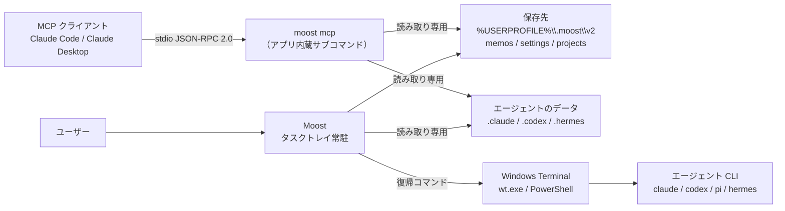

要点:

- Moost は**読み取り専用**。エージェント側データには一切書き込まない
- 復帰は「コマンドを組み立てて端末に渡す」だけで、Moost 自身はセッションを保持しない
- MCP サーバーは**別プロセスを要求しない**（`moost mcp` として同梱）

---

## 2. リポジトリ構成と分離境界

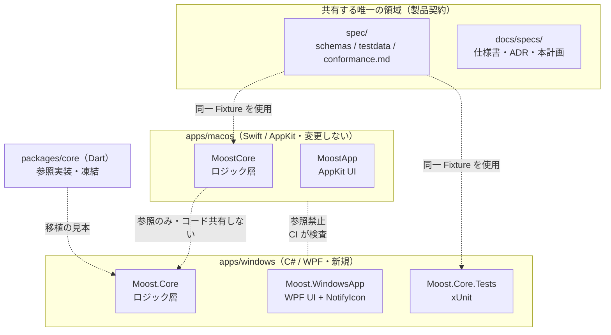

分離のルール（CI の分離ゲートで強制）:

| ルール | 検査内容 |
|---|---|
| 言語の非混在 | `apps/macos` に `.cs`、`apps/windows` に `.swift` を置かない |
| 相互参照の禁止 | `apps/macos` から `../windows`、`apps/windows` から `../macos` を参照しない |
| 条件コンパイルの禁止 | `#if os(Windows)` / `#if os(macOS)` / `OS_WINDOWS` を使わない |
| 共有層の限定 | 共有ディレクトリは `spec/` のみ（`shared/` 等を新設しない） |
| ワークフローの非交差 | リリース CI のタグ接頭辞が相手側を拾わない |

---

## 3. Windows アプリのレイヤー構成

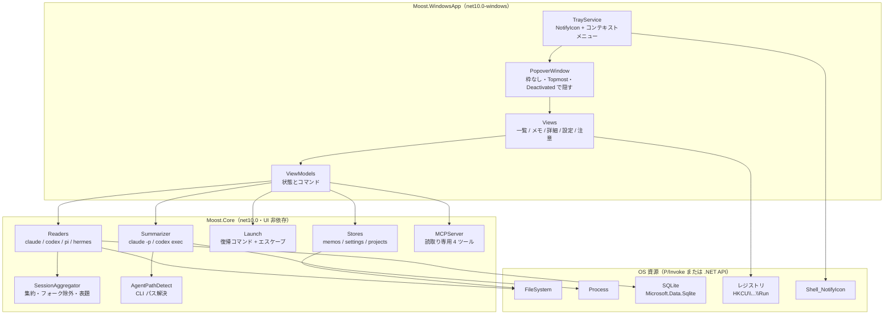

依存方向は **UI → Core → OS** の一方通行。`Moost.Core` は WPF を参照しない
（macOS の「Core は AppKit/SwiftUI を import しない」という性質の写像）。

---

## 4. データフロー: 直近セッション一覧

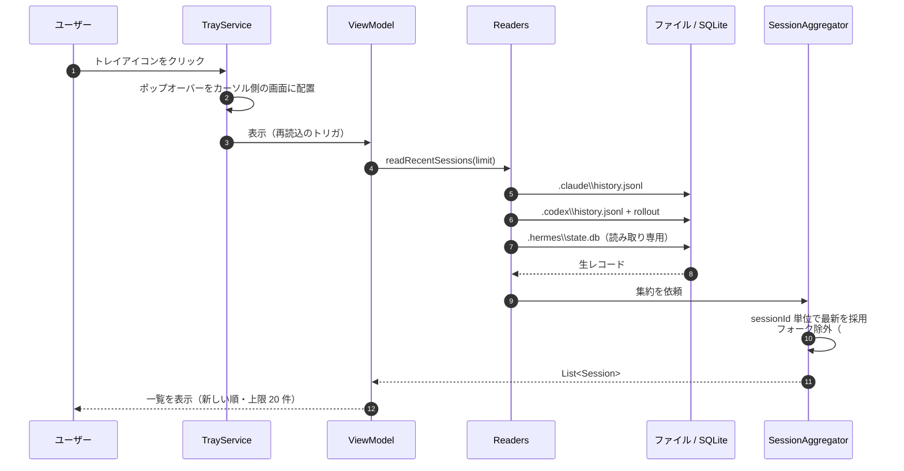

---

## 5. 復帰フロー（ワンクリック復帰）

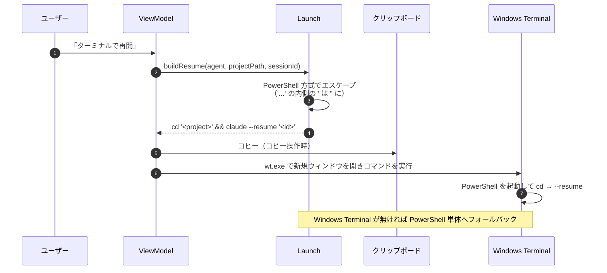

危険文字（`$` `;` `|` `&&` `>` バッククォート `'` `\` 空白）を含むパスでも
コマンドが壊れず、注入も成立しないことをテストで担保する（conformance G1）。

---

## 6. UI 状態遷移（常駐アプリの振る舞い）

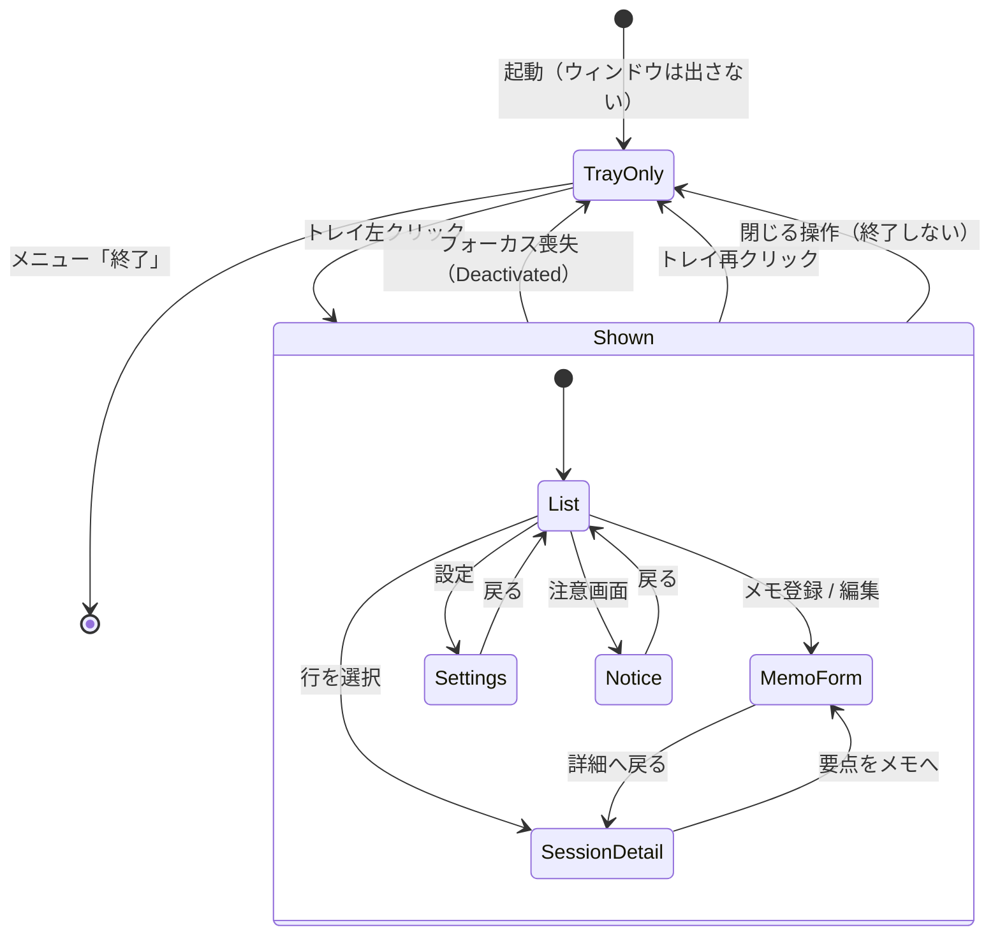

macOS の NSPopover と同じく「アプリ外を触ると隠れる」。トレイクリック直後の
blur → hide の競合（design.md 7 章のハマりどころ）にはガードを入れる。

---

## 7. リリースフロー（プラットフォーム完全分離）

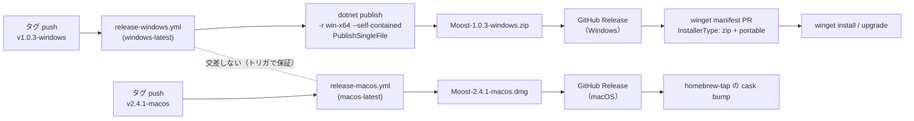

バージョンの写像:

| タグ | 成果物 | winget `PackageVersion` | cask `version` |
|---|---|---|---|
| `v1.0.3-windows` | `Moost-1.0.3-windows.zip` | `1.0.3`（接尾辞なし） | — |
| `v2.4.1-macos` | `Moost-2.4.1-macos.dmg` | — | `2.4.1-macos` |

---

## 8. CI の分離とゲート

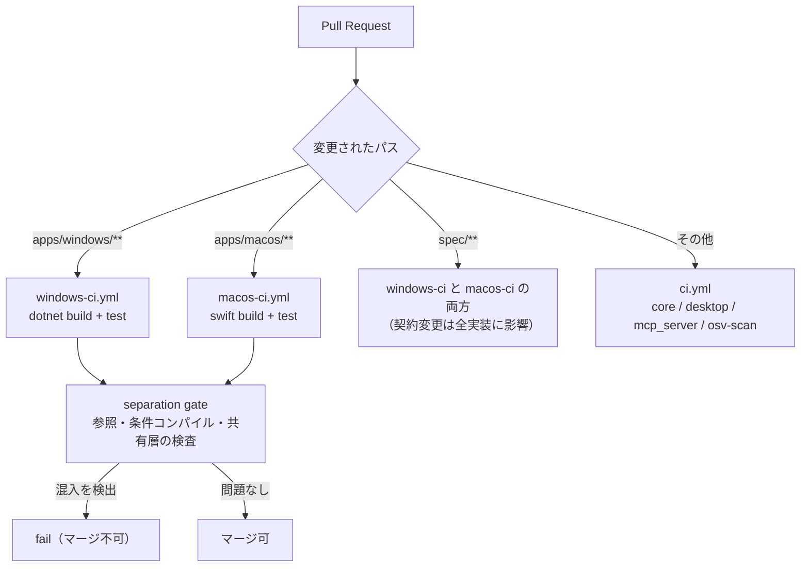

「片方の変更で両方が走る」状態を避けることが目的。例外は `spec/**` のみで、
これは**意図的な交差**（データ契約の変更は全実装に影響するため）。

---

## 9. conformance ゲート（言語に依存しない合格条件）

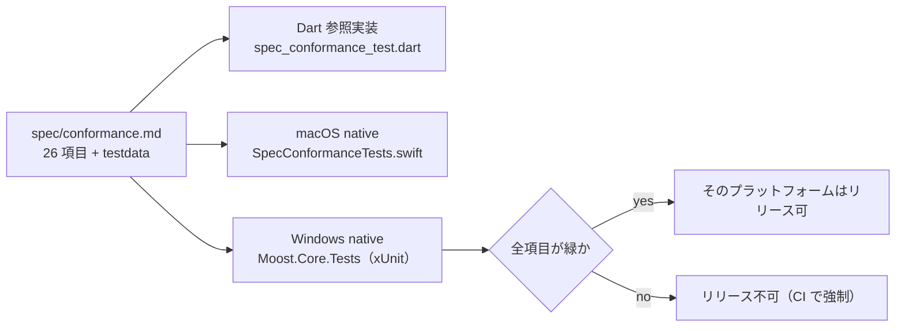

項目の内訳: A（JSON 永続 3）・B（memos 6）・C（settings 4）・D（projects 2）・
E（一覧 7）・F（表題 2）・G（復帰 2）＋ H（プラットフォーム受け入れ）。

---

## 10. データ配置

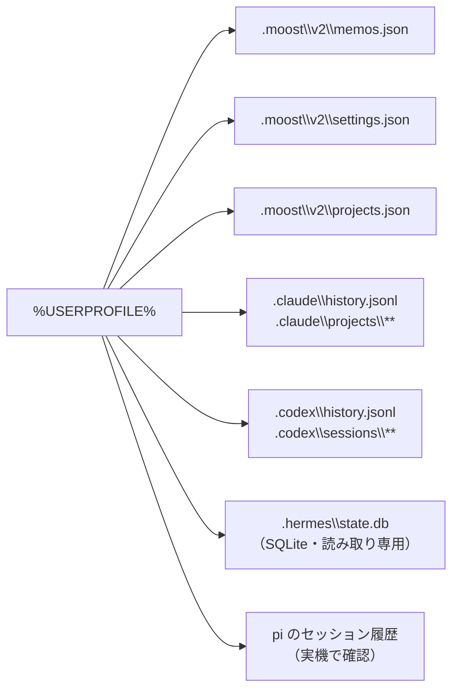

- 保存先は `%USERPROFILE%\.moost\v2\`（macOS の `~/.moost/v2/` に対応）
- **Windows には旧版データが無いため v1 → v2 移行は不要**
- アンインストールしてもメモは残る（`.moost` は消さない）

---

## 11. タスク依存（チケット）

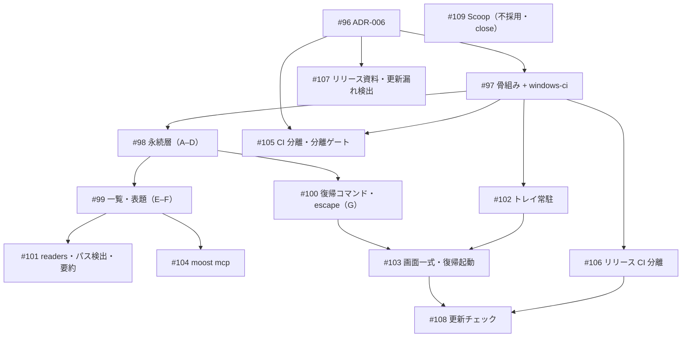

---

## 12. リスクと対策

| リスク | 影響 | 対策 |
|---|---|---|
| 各エージェントの Windows 実パスが未検証 | 一覧が空になる | #101 の着手時に実機で最初に確認する |
| Hermes の SQLite 読み取り | 一覧・抜粋が出ない | `Microsoft.Data.Sqlite` を追加（クールダウン 7 日 + osv-scanner を通す） |
| 要約のサブプロセスがハング | UI が固まる | stdout/stderr の同時読み・タイムアウト・キャンセル |
| 二重保守のドリフト | macOS と挙動が違う | conformance をリリースゲートにする（#105）／`spec/` 先行更新 |
| winget の検証待ち | 「出した瞬間に入らない」 | zip が即時性を担保（#106） |
| SmartScreen 警告（ブラウザ経由 DL） | 導入の離脱 | README に回避手順を明記（#107） |
| 分離の形骸化 | 時間とともに混ざる | 分離ゲートで機械的に強制（#105） |
